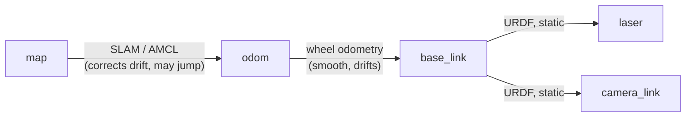

# Phase 1: Environment setup and stack smoke test

**Goal:** confirm that every piece of software the project depends on is installed and
works together, *before* writing any of our own code. If something breaks later, we then
know it is our code, not the installation.

## 1. The software stack

| Layer | Package(s) | Role |
|---|---|---|
| Middleware | ROS 2 Humble (`ros-humble-desktop`) | Processes ("nodes") exchanging messages over DDS |
| Simulator | Gazebo Classic 11 + `gazebo_ros_pkgs` | Physics, sensor simulation, ROS plugins |
| Robot model | `xacro`, `robot_state_publisher` | Turn the robot description into TF frames |
| Mapping | `slam_toolbox` | SLAM: build a map while localising |
| Navigation | `navigation2`, `nav2_bringup`, `nav2_simple_commander` | Localisation (AMCL), planning, control |
| Reference robot | `turtlebot3*` | Known-good robot to test the stack with |
| Tools | `rviz2`, `teleop_twist_keyboard`, `tf2_tools` | Visualise, drive, inspect TF |

Install command used:

```bash
sudo apt install ros-humble-gazebo-ros-pkgs ros-humble-navigation2 ros-humble-nav2-bringup \
  ros-humble-nav2-simple-commander ros-humble-slam-toolbox ros-humble-turtlebot3 \
  ros-humble-turtlebot3-gazebo ros-humble-turtlebot3-navigation2 ros-humble-turtlebot3-teleop \
  ros-humble-xacro ros-humble-joint-state-publisher python3-colcon-common-extensions
```

## 2. Shell environment (`~/.bashrc`)

ROS finds packages through environment variables (`AMENT_PREFIX_PATH`, `PYTHONPATH`, …)
that "setup" scripts add to. `~/.bashrc` runs when a terminal opens, so it holds:

```bash
source /opt/ros/humble/setup.bash              # the ROS 2 installation ("underlay")
export TURTLEBOT3_MODEL=burger                 # read by every turtlebot3 launch file / node
source /usr/share/gazebo/setup.sh              # Gazebo model / plugin / resource paths
[ -f ~/ros2_ws/install/setup.bash ] && source ~/ros2_ws/install/setup.bash  # our workspace ("overlay")
```

> **Lesson learned:** `.bashrc` only affects terminals opened *after* it changes. A terminal
> that was already open needs `source ~/.bashrc`. The `KeyError: 'TURTLEBOT3_MODEL'` error we
> hit was exactly this.

**Underlay vs overlay:** our workspace (`~/ros2_ws/install`) is sourced *after* `/opt/ros`,
so if a package exists in both, ours wins. That's how you can patch a ROS package locally.

## 3. Core concepts

### Nodes, topics, messages
A **node** is a process with one job (e.g. `slam_toolbox`). Nodes publish **messages** on
named **topics** (`/scan`, `/map`) and anyone can subscribe. Publishers and subscribers don't
know about each other; DDS discovery connects them automatically on the same
`ROS_DOMAIN_ID`. Useful commands:

```bash
ros2 node list                 # who is running
ros2 topic list                # what is being published
ros2 topic info /cmd_vel -v    # publishers/subscribers + QoS of a topic
ros2 topic hz /scan            # publish rate
ros2 topic echo /odom          # print messages
```

> **Debugging story:** when the robot "wouldn't move", `ros2 topic info /cmd_vel` showed
> *Publisher count: 0*. Gazebo's diff-drive was subscribed and fine; the teleop node simply
> wasn't running. Same with RViz showing nothing: `/map` had a single subscriber (SLAM
> itself), so RViz had no Map display added. **Check the graph before guessing.**

### QoS (Quality of Service)
Each topic connection negotiates reliability and durability. Two that matter here:
- **Sensor data** (`/scan`) is *best-effort*: dropping an old scan is better than delaying a new one.
- **The map** (`/map`) is *transient-local*: the publisher keeps the last message and hands it
  to late joiners, so RViz opened after SLAM still gets the map.

A subscriber whose QoS is incompatible with the publisher silently receives nothing. That's a
classic "the topic exists but I get no data" bug.

### TF: the transform tree
Every piece of sensor data is stamped with a **frame** (`laser`, `base_link`, …). TF is a
distributed tree of the transforms between frames, *over time*, so any node can ask
"where was the laser relative to the map at t = 12.3 s?".

The standard mobile-robot chain ([REP-105](https://www.ros.org/reps/rep-0105.html)):



- `odom → base_link` is continuous and smooth but accumulates drift (wheel slip, rounding).
- `map → odom` is published by the localisation system. It is the *correction*: it can jump
  when SLAM recognises a place, but it keeps `map → base_link` globally correct.
- Splitting it this way means controllers can use the smooth `odom` frame while planners use
  the globally-consistent `map` frame.

### Simulation time (`use_sim_time`)
Gazebo publishes its own clock on `/clock`. It can run slower or faster than real time and it
pauses. With `use_sim_time: true` a node uses `/clock` instead of the wall clock. **Every**
node must agree: if one node stamps data with wall time (~1.7 billion seconds) and another
with sim time (~100 seconds), TF lookups fail with *"extrapolation into the future"*.

## 4. The smoke test

TurtleBot3 world + slam_toolbox, verified headless (gzserver only) with scripted `/cmd_vel`:

| Check | Result |
|---|---|
| Topics `/scan /odom /cmd_vel /map /clock /tf` present | ✅ |
| Lidar rate | ✅ 5 Hz (TurtleBot3 default) |
| Map building after ~12 s of driving | ✅ 81×102 cells @ 5 cm: 1654 free, 174 occupied |
| `map → base_footprint`, `odom → base_scan` resolve | ✅ |

To reproduce with GUIs:

```bash
ros2 launch turtlebot3_gazebo turtlebot3_world.launch.py
ros2 launch slam_toolbox online_async_launch.py use_sim_time:=true
rviz2 -d /opt/ros/humble/share/slam_toolbox/config/slam_toolbox_default.rviz --ros-args -p use_sim_time:=true
ros2 run turtlebot3_teleop teleop_keyboard
```
