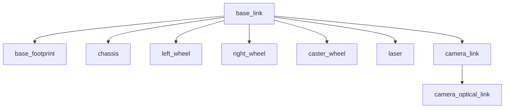
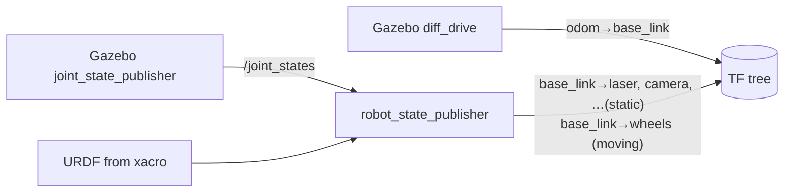
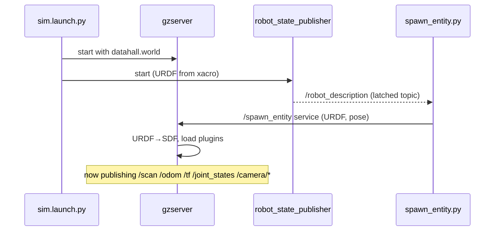

# Phase 2: Custom robot and data-hall world

**Goal:** replace the borrowed TurtleBot3 with our own robot, `dc_robot`, in our own
environment, and make it speak the standard ROS interfaces (`/cmd_vel`, `/odom`, `/scan`, TF)
so that everything built later (SLAM, Nav2, our nodes) works unchanged.

Package: `src/dc_robot` (ament_python: no C++ to compile; the package installs files).

```
dc_robot/
├── urdf/
│   ├── dc_robot.urdf.xacro    # body, wheels, caster; all dimensions as properties
│   ├── inertial_macros.xacro  # inertia formulas
│   ├── sensors.xacro          # lidar + camera (links + Gazebo sensor plugins)
│   └── gazebo.xacro           # friction, colours, diff_drive & joint_state plugins
├── worlds/                    # datahall.world (default), warehouse.world: GENERATED
├── scripts/generate_worlds.py # layout tables -> .world files
├── launch/  rsp.launch.py, sim.launch.py
└── rviz/    sim.rviz
```

## 1. Describing a robot: URDF and Xacro

**URDF** (Unified Robot Description Format) is XML describing a robot as a tree of
**links** (rigid bodies) connected by **joints**.

Each link has up to three independent parts:
- `<visual>`: what you *see* (RViz, Gazebo rendering)
- `<collision>`: what *physically touches* things (often a simpler shape than the visual)
- `<inertial>`: mass and inertia tensor, for the physics engine

Joint types used here: `fixed` (sensors, chassis), `continuous` (wheels: unlimited rotation).

**Xacro** is a macro language on top of URDF: properties (`${wheel_radius}`), math
(`${-pi/2}`), macros, and file includes. The real URDF is generated at launch time:

```python
robot_description = ParameterValue(Command(['xacro ', xacro_file]), value_type=str)
```

Example: both wheels come from one macro, so changing `wheel_separation` in one place updates
the URDF *and* the diff-drive plugin, which reads the same property. No chance of the two
disagreeing.

### The robot

| Property | Value | Why |
|---|---|---|
| Chassis | 0.34 × 0.26 × 0.10 m, 3.0 kg | small enough for 1.2 m rack aisles |
| Wheels | r = 0.05 m, separation 0.31 m | |
| Overall footprint | ≈ 0.34 × 0.35 m | used by Nav2's costmap in Phase 4 |
| Caster | frictionless sphere r = 0.025 m, at x = −0.18 | stable, no swivel dynamics |
| Lidar | 1440 samples (0.25°), 0.12–12 m, 10 Hz, σ = 1 cm | similar to a Hokuyo UST-10LX (was 360 / 1° until Phase 4b, see [04b](04b-datacenter.md)) |
| Camera | RGB-D (depth), 160×120, 87° FOV, 10 Hz, on a mast 0.32 m up, tilted 20° down | like an Intel RealSense; feeds the costmaps' voxel layer (Phase 4b). Was a 640×480 RGB camera on the chassis |

### Frames (REP-105)



- **`base_link` sits on the wheel axle, midway between the wheels.** A differential-drive
  robot rotates about this point, so a pure rotation command leaves `base_link`'s position
  unchanged. This simplifies Nav2's motion model and footprint checks.
- **`base_link` has no mass.** KDL (the kinematics library inside `robot_state_publisher`)
  doesn't support inertia on the root link, so the mass lives in the child `chassis` link,
  which is offset 6 cm *behind* the axle so the caster carries load and the robot doesn't tip forward.
- **`base_footprint`** = `base_link` projected to the floor. Some tools expect it.
- **`camera_optical_link`**: cameras have their own convention (z forward, x right, y down),
  so image-processing libraries get a frame they understand. It's just a rotation of
  `camera_link` by (−90°, 0, −90°).

### Inertia: why it matters
Gazebo integrates Newton's laws. The inertia tensor says how hard a body is to *rotate*
about each axis. For a uniform solid box of mass *m* and sides *x, y, z*:

$$I_{xx} = \tfrac{m}{12}(y^2+z^2),\quad I_{yy} = \tfrac{m}{12}(x^2+z^2),\quad I_{zz} = \tfrac{m}{12}(x^2+y^2)$$

(cylinder and sphere formulas are in `inertial_macros.xacro`). Zero or wildly wrong inertia
makes the simulation numerically unstable: the robot jitters, sinks, or launches itself.

## 2. Connecting Gazebo to ROS: plugins

Gazebo knows nothing about ROS. **Plugins** (shared libraries loaded from `<gazebo>` blocks
in the URDF) bridge the two.

| Plugin | Subscribes | Publishes |
|---|---|---|
| `libgazebo_ros_diff_drive.so` | `/cmd_vel` (Twist) | `/odom`, TF `odom → base_link` |
| `libgazebo_ros_joint_state_publisher.so` | | `/joint_states` (wheel angles) |
| `libgazebo_ros_ray_sensor.so` | | `/scan` (LaserScan, frame `laser`) |
| `libgazebo_ros_camera.so` (depth) | | `/camera/image_raw`, `/camera/depth/image_raw`, `/camera/points`, `/camera/camera_info` |

### Differential drive kinematics
A Twist command has a forward speed *v* (`linear.x`) and a turn rate *ω* (`angular.z`).
With wheel separation *L* and radius *r*, each wheel's angular velocity is:

$$\omega_{L} = \frac{v - \omega L/2}{r}, \qquad \omega_{R} = \frac{v + \omega L/2}{r}$$

The plugin applies those to the wheel joints (limited by `max_wheel_torque` and
`max_wheel_acceleration`), then **integrates the measured wheel rotation back** into a pose
estimate, which is odometry.

`odometry_source: 0` (encoder) means odometry is computed from the wheels, so it **drifts**
like a real robot's (slip, caster drag). The alternative `1` (world) publishes Gazebo's
perfect ground-truth pose: easier, but then SLAM/AMCL would have nothing to correct and the
project would be less realistic.

### Who publishes which TF?



### Surfaces
Drive wheels: `mu1 = mu2 = 1.0` (grip) and a stiff contact (`kp = 1e6`, `kd = 100`) so they
don't sink into the floor. Caster: `mu = 0.001`, effectively a frictionless ball transfer unit.

### Ground truth (`/ground_truth/odom`)
`libgazebo_ros_p3d.so` publishes Gazebo's *exact* pose of `base_link`. **No robot software
uses it**, since a real robot has nothing like it. It exists purely as a measuring stick:
it's how the wheel-slip bug below was found, and how SLAM/AMCL accuracy is measured.

## 3. Bug found: the lidar was seeing the robot

**Symptom:** about 6 readings per scan at 0.12–0.17 m, scattered across the front sector,
even in an empty world. Nav2 would treat these as obstacles touching the robot and refuse to move.

**Investigation:** a controlled experiment, counting phantom returns (< 0.5 m) over 20 scans in
an empty world:

| Configuration | Phantoms / scan |
|---|---|
| CPU `ray` sensor, scan plane 2 cm above chassis (original) | **6.2** |
| CPU `ray`, lidar raised on a 5 cm standoff | **0** |
| `gpu_ray`, original height | **0** |

**Cause:** Gazebo's CPU ray sensor uses the ODE physics collision engine. With the scan plane
only 2 cm above the chassis box, ODE intermittently registers ray hits on the robot's own
collision geometry.

**Fix:** a 5 cm lidar standoff (`lidar_mount_height`), keeping the CPU sensor because it
works without a GPU (VMs, CI, other people cloning the repo). Real robots mount lidars
high for the same reason: a clear 360° field of view.

> **Side lesson:** a first round of these experiments gave misleading results because old
> Gazebo processes from previous runs were still alive and publishing `/scan`. A background
> `ros2 launch` in a script ignores SIGINT; it must be started in its own process group
> (`setsid`) and the group killed. **If results look inconsistent, check
> `pgrep -fa gzserver` for zombies.**

## 4. Bug found (in Phase 3): the wheels were slipping

**Symptom:** during the first SLAM mapping run, the gap between wheel odometry and SLAM's
pose grew to **15 m**. The map itself was fine, so SLAM was quietly absorbing the error.

**Misleading first test:** spinning in place showed odometry and SLAM agreeing perfectly.
But SLAM *trusts odometry as its starting guess*, so agreement between the two proves nothing.
**You need an independent ground truth.** That's why the p3d plugin was added.

**Measured against ground truth** (each manoeuvre commanded ≈ 90°):

| Wheel collision shape | True turn | Odometry claims | Error |
|---|---|---|---|
| Cylinder (original) | 81–83° | 89–90° | **~8% (≈ 7–8° per 90° turn)**, on arcs *and* spins |
| Sphere | 88–90° | 88–90° | **< 0.1°** |

**Cause:** a cylinder lying on a plane touches it along a line. ODE approximates that with
several contact points across the 4 cm tread, each with its own friction constraint. When
the wheel turns while rolling, those points want to move at slightly different speeds, so
they fight each other and the wheel scrubs. The robot rotates less than the wheel
encoders say. A heading error of 7° means that after driving 10 m the position estimate is
off by about 1.2 m, which is where the metres of drift came from.

**Fix:** a sphere collision of the same radius: exactly one contact point, directly under the
wheel centre. The *visual* is still a cylinder. This is a well-known Gazebo Classic technique.

**Why it matters even though SLAM coped:** in Phase 4, AMCL uses odometry as its *motion
model* between scans. With 8% rotational error the particle filter has to spread particles
much wider to keep up, which makes localisation slower and less certain.

## 5. The world: a data hall

`worlds/*.world` files are **generated** by `scripts/generate_worlds.py` from layout tables
(lists of `Box`, `Cylinder`, `wall(...)`), so the layout is readable and easy to change:

```bash
python3 src/dc_robot/scripts/generate_worlds.py    # regenerate after editing a layout
```

### Layout: 20 × 14 m (x ∈ [−10, 10], y ∈ [−7, 7])

```
y= 6.45  [CRAC]   [CRAC]   [CRAC]   [CRAC]                ┌── NOC office ──┐
y= 4.0   ▓▓▓▓▓▓▓▓▓▓▓▓▓▓ row A ▓▓▓▓  ║  ▓▓▓▓▓▓▓▓▓           │ desk, cabinet  │
              hot aisle             ║                     └──── door ──────┘
y= 1.6   ▓▓▓▓▓▓▓▓▓▓▓▓▓▓ row B ▓▓▓▓  ║  ▓▓▓▓▓▓▓▓▓      ●          [PDU]
              cold aisle            ║  (cross aisle)                 [PDU]
y=-0.8   ▓▓▓▓▓▓▓▓▓▓▓▓▓▓ row C ▓▓▓▓  ║  ▓▓▓▓▓▓▓▓▓
              hot aisle             ║                 ●
y=-3.2   ▓▓▓▓▓▓▓▓▓▓▓▓▓▓ row D ▓▓▓▓  ║  ▓▓▓▓▓▓▓▓▓       ┌── cage ──gate──
         [UPS][UPS][UPS]  🤖(−6,−5.2)      ●            │ crates
```

- **76 racks** (600 × 1200 × 2000 mm, standard 42U), in a **hot/cold-aisle** layout: rack
  fronts face the cold aisles (cool supply air), backs face the hot aisles (exhaust). This is
  how real data halls are arranged; the green and blue LED strips mark the fronts.
- **1.2 m aisles** (real-world standard) vs a 0.35 m robot: a real test of Nav2 tuning.
- **Cross aisle** (1.8 m) splits each row: the planner gets loops and route choices.
- **Landmarks** (CRAC units, UPS, PDUs, columns, office, cage) give SLAM unique features.
- **Closed outer walls**, so the map is a bounded region (needed by frontier exploration).
- **Every obstacle is taller than the 0.22 m scan plane.** A 2D lidar cannot see anything
  below its plane: a low box would be invisible to SLAM and Nav2.
- Collision boxes of adjacent racks touch (the lidar sees a solid row), but their *visuals*
  are shrunk 3% to show seams between cabinets: visual and collision are independent.

### Why a data hall is a hard SLAM environment
Long, identical aisles look the same to a 2D lidar. This is **perceptual aliasing**: scan
matching can't tell aisle 1 from aisle 3. This is addressed in [Phase 3](03-slam.md).

## 6. Launch files

**`rsp.launch.py`** runs `robot_state_publisher` with the xacro-generated URDF.

**`sim.launch.py`** brings it all up:



Arguments: `world:=datahall|warehouse|<path>`, `gui:=false`, `rviz:=false`, `x/y/yaw`. The
spawn pose defaults to a known-free spot for the chosen world (an `OpaqueFunction` resolves
it at launch time).

**Fixed-joint lumping:** when converting URDF to SDF, Gazebo merges links joined by `fixed`
joints into their parent (chassis, laser and camera all become part of `base_link`), which makes
the physics faster and more stable. Sensors attached to lumped links keep their correct offset.

## 7. Verification (headless)

| Check | Result |
|---|---|
| Spawn | ✅ about 5 s |
| `/scan` 10 Hz · `/odom` 50 Hz · `/camera/image_raw` 15 Hz (10 Hz since the Phase 4b depth camera) | ✅ |
| Real-time factor in the data hall (178 objects) | ✅ 1.00 |
| Lidar vs layout: left 1.41 (exp. 1.43), right 0.85 (0.85), behind 3.90 (3.9) m | ✅ |
| Phantom returns over 20 scans | ✅ 0 |
| `cmd_vel` 0.2 m/s × 3 s → 0.62 m | ✅ |
| TF `odom→base_link→{laser, camera_optical_link, wheels, base_footprint}` | ✅ |

Try it:
```bash
ros2 launch dc_robot sim.launch.py                       # data hall + RViz
ros2 run teleop_twist_keyboard teleop_twist_keyboard     # i / j / l / k
ros2 run tf2_tools view_frames                           # writes frames.pdf
```
