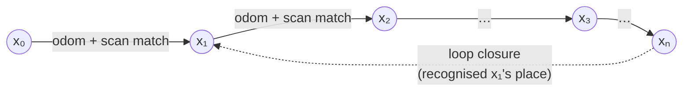
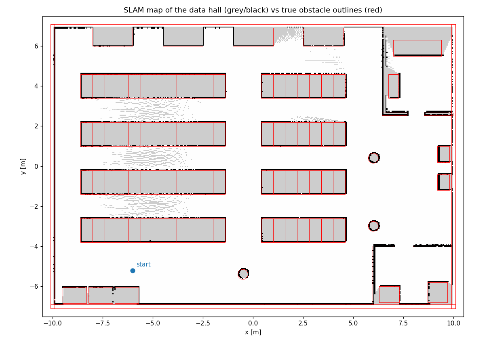

# Phase 3: SLAM (mapping the data hall)

**Goal:** drive the robot around an unknown environment and build an accurate 2D map of it,
then save that map so Phase 4 can navigate on it.

Files added in `src/my_robot`:

| File | Purpose |
|---|---|
| `config/slam_params.yaml` | slam_toolbox parameters; every change from the defaults is marked `# TUNED` |
| `launch/slam.launch.py` | starts `async_slam_toolbox_node` + RViz (`rviz/slam.rviz`) |
| `rviz/slam.rviz` | top-down map view, laser, robot, TF + slam_toolbox's control panel |
| `maps/datahall.{pgm,yaml}` | the saved map |

## 1. What problem SLAM solves

To build a map you need to know where the robot is. To know where the robot is you need a
map. **SLAM** (Simultaneous Localisation And Mapping) solves both at once.

Odometry alone isn't enough: it integrates small wheel errors forever, so the robot's believed
position drifts without bound, and a map drawn from that position would smear and bend.
SLAM uses the **lidar** to correct the drift: if the walls in the new scan line up with the walls
already in the map only when the robot is 3 cm to the left of where odometry says, then the
robot *is* 3 cm to the left.

### SLAM vs AMCL (Phase 4)

| | SLAM (slam_toolbox) | AMCL |
|---|---|---|
| Map | **builds** it | **given** a fixed map |
| Estimates | robot trajectory **and** map | robot pose only |
| Algorithm | graph optimisation | particle filter |
| Publishes | `/map`, TF `map → odom` | TF `map → odom` |
| Use it when | exploring somewhere new | operating in a known place |

Both publish the same TF (`map → odom`), which is why the rest of the stack doesn't care
which one is running.

## 2. How slam_toolbox works: graph-based SLAM

slam_toolbox (based on Karto SLAM) keeps a **pose graph**:



- **Nodes** = robot poses where a scan was kept (each node stores its scan).
- **Edges** = spatial constraints between poses ("x₂ is 0.31 m ahead of x₁, rotated 2°"),
  each with an uncertainty.

### Step 1: Front end: scan matching (every new scan)
A new node is added only after the robot moves `minimum_travel_distance` (0.3 m) or turns
`minimum_travel_heading` (0.3 rad), so a parked robot doesn't bloat the graph.

1. **Prediction:** odometry says how far the robot moved since the last node. That's the initial guess.
2. **Correlative scan matching:** search a window around that guess
   (`correlation_search_space_dimension` = ±0.25 m, angles ±`coarse_search_angle_offset`)
   for the pose where the new scan best overlaps the recent scans
   (`scan_buffer_size` = 10 of them). Coarse grid first, then fine
   (`correlation_search_space_resolution` = 1 cm, `fine_search_angle_offset` ≈ 0.2°).
3. The best pose and its **response** (overlap score 0–1) and covariance become a new edge.

### Step 2: Back end: loop closure + optimisation
Odometry and sequential scan matching still drift slowly (each edge has a small error). When
the robot comes back to somewhere it has been before:

1. Candidate old nodes within `loop_search_maximum_distance` (3 m) of the current pose estimate are found.
2. The current scans are matched against those old scans over a much larger window
   (`loop_search_space_dimension` = 8 m). A loop closure is **accepted** only if the match is
   strong (`loop_match_minimum_response_coarse/fine`) and consistent over a chain of
   `loop_match_minimum_chain_size` = 10 scans.
3. A new edge "now ≈ then" is added, and **Ceres** (a non-linear least-squares solver) adjusts
   *all* poses to best satisfy *all* edges. The accumulated error gets spread across the whole
   loop instead of piling up at the end.

### Step 3: Output
- The map: every kept scan is ray-traced from its (optimised) pose into an **occupancy grid**.
- TF `map → odom`: the difference between where SLAM thinks the robot is and where odometry
  thinks it is.

### "Online async"
- *Online*: runs live on incoming data (not on a recorded bag).
- *Async*: if processing falls behind, it skips to the newest scan instead of queueing.
  It keeps `map → odom` current, which matters more while driving than using every scan.

## 3. The occupancy grid

`nav_msgs/OccupancyGrid`: a 2D array of cells, each 5 cm × 5 cm here (`resolution: 0.05`).

| Cell value | Meaning | Image colour |
|---|---|---|
| 0 | free (a laser beam passed through) | white |
| 100 | occupied (a laser beam ended here) | black |
| −1 | unknown (never observed) | grey |

Each cell is decided by counting: how often beams *ended* in it vs *passed through* it
(`min_pass_through`, `occupancy_threshold`).

When saved with `map_saver_cli`, it becomes two files:

```yaml
# maps/datahall.yaml
image: datahall.pgm          # greyscale picture of the grid
resolution: 0.05             # metres per pixel
origin: [-3.94, -1.73, 0]    # world pose of the bottom-left pixel (x, y, yaw)
occupied_thresh: 0.65        # pixel darkness above which a cell is occupied
free_thresh: 0.25            # below which it is free; in between = unknown
mode: trinary
```

> **Note on `origin`:** the `map` frame starts wherever the robot was when SLAM started
> (the spawn point, world (−6.0, −5.2)). So map coordinates = world coordinates − (−6.0, −5.2).
> That's why the origin is not (−10, −7). Phase 4 must start the robot at the same place, or
> you give AMCL the right initial pose.

## 4. Tuning choices (`config/slam_params.yaml`)

| Parameter | Default → ours | Reason |
|---|---|---|
| `base_frame` | base_footprint → **base_link** | our URDF root |
| `max_laser_range` | 20 → **12** m | the lidar's real range; beyond it a reading is "no return", not an obstacle |
| `min_laser_range` | 0 → **0.12** m | lidar minimum |
| `map_update_interval` | 5 → **2** s | smoother live map in RViz |
| `minimum_travel_distance/heading` | 0.5 → **0.3** | more nodes in 1.2 m aisles: turns into/out of aisles are captured |
| `loop_match_minimum_response_coarse` | 0.35 → **0.40** | stricter loop closure… |
| `loop_match_minimum_response_fine` | 0.45 → **0.50** | …because of perceptual aliasing (below) |

### Perceptual aliasing: why data halls are hard
A 2D lidar in rack aisle 1 sees two long parallel walls. So does a lidar in aisle 3. Scan
matching can't tell them apart, and slides *along* an aisle are hard to detect, because a
corridor looks identical from any point along its length. A **false loop closure** ("this is
aisle 1" when it's aisle 3) would be catastrophic: the optimiser would fold the map onto itself.

Mitigations:
1. Stricter loop-closure thresholds (above).
2. Landmarks in the world: CRAC units, columns, PDUs, office and cage give unique scans at
   aisle ends.
3. Drive *across* aisle ends (where rows terminate) more than *down* long aisles when mapping.
   The row ends are the distinctive features.

## 5. Results

The map was built headlessly by a scripted 80 m route through every area of the hall
(steering on the SLAM pose, with a safety stop), then saved and **scored against the true
geometry** from the world file:



| Metric | Result | Meaning |
|---|---|---|
| Size | 19.9 × 13.9 m | hall is 20 × 14 m (wall centres) |
| **Precision** | **99.9 %** | occupied cells within 10 cm of a real obstacle: no phantom walls, no ghosting |
| **Wall hit** | **91.5 %** | visible obstacle faces that appear in the map |
| **Coverage** | **92.8 %** | true free floor marked as free |
| Odom vs SLAM gap after 80 m | ~1 m (1.3 %) | normal wheel-odometry drift, corrected by SLAM |

The missing ~7 % coverage is the speckled grey *inside* the rack aisles: the route drove along
the aisle ends, and the lidar sees down an aisle only at shallow angles. Driving down the
aisles fills it in. That's exactly what frontier exploration (Phase 5) will do automatically.

### The bug this phase uncovered
The first mapping run showed a 15 m gap between odometry and SLAM. The map was still perfect,
because SLAM absorbed the error, but the robot's wheels were slipping by about 8% on every
turn. Found with a ground-truth plugin and fixed with sphere wheel collisions. Full write-up:
[Phase 2 § 4](02-robot-and-world.md#4-bug-found-in-phase-3-the-wheels-were-slipping).

## 6. Do it yourself

```bash
# T1: simulation (RViz off; SLAM brings its own layout)
ros2 launch my_robot sim.launch.py rviz:=false

# T2: SLAM + mapping RViz
ros2 launch my_robot slam.launch.py

# T3: drive (keep this terminal focused): i forward, j/l turn, k stop, q/z speed up/down
ros2 run teleop_twist_keyboard teleop_twist_keyboard
```

Mapping tips:
- **Go slowly**, especially when turning: fast rotation blurs scans.
- **Close loops**: return to areas you've seen from a different direction.
- Drive along the cross aisle and the aisle ends; then go down a few aisles to fill them in.

### When the map goes wrong (and why)

Symptom: the map suddenly "shifts", or walls appear twice (a double image).

| Cause | What really happens |
|---|---|
| **Hitting a wall/rack** | wheels keep spinning while the robot is stuck, so odometry reports motion that never happened |
| **Hard acceleration/braking or fast turns** | the wheels **slip** (Gazebo simulates friction: ask for more force than friction allows and the tyre spins), with the same effect on odometry |
| **Fast rotation** | the lidar sweeps 360° over 0.1 s; at 2 rad/s the robot turns ~11° *during one scan*, so the scan is bent. slam_toolbox assumes each scan came from a single pose and does not de-skew. |

All three break the same step. Scan matching uses odometry as its initial guess and only
searches **±0.25 m / ±20°** around it (`correlation_search_space_dimension`,
`coarse_search_angle_offset`). If the guess is worse than that, the matcher can't find the
true pose or locks onto a wrong one. Later scans are then drawn in the wrong place on top of
a correct map. That's the "shift". The robot is mislocalised. The old map is still fine.

- **Light bump:** stop, back off slowly, wait. Small errors often recover on the next matches.
- **Double walls:** restart sim **and** SLAM (so `map` starts at the spawn point again).
  Nothing on disk changes until you run `map_saver_cli`.
- **Prevention:** keep speeds ≲ 0.25 m/s and ≲ 0.8 rad/s (press `z` ~5× in teleop; its default
  is 0.5 m/s / 1.0 rad/s and `q` raises both 10 % per press). The provided map was built at
  0.25 m/s / 0.6 rad/s. For reference, a TurtleBot3 Burger tops out at 0.22 m/s.

Save the map from the workspace root (overwrites the provided one):

```bash
cd ~/ros2_ws
ros2 run nav2_map_server map_saver_cli -f src/my_robot/maps/datahall
colcon build --symlink-install     # installs new map files
```

Optional: save slam_toolbox's full pose graph (so you can continue mapping later) from the
**SlamToolboxPlugin** panel in RViz → *Serialize Map*.

### Inspect what's happening

```bash
ros2 run tf2_ros tf2_echo map odom     # the drift correction; watch it change as you drive
ros2 topic hz /map                     # ~every 2 s (map_update_interval)
ros2 run tf2_tools view_frames         # now includes map → odom
```
