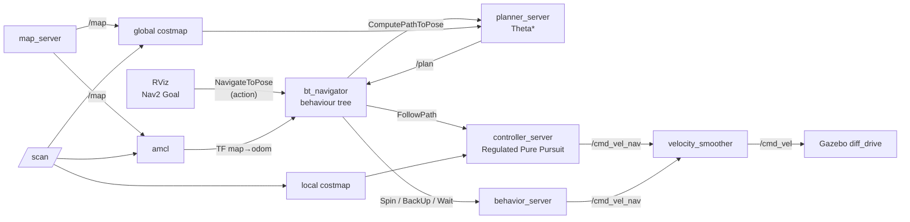
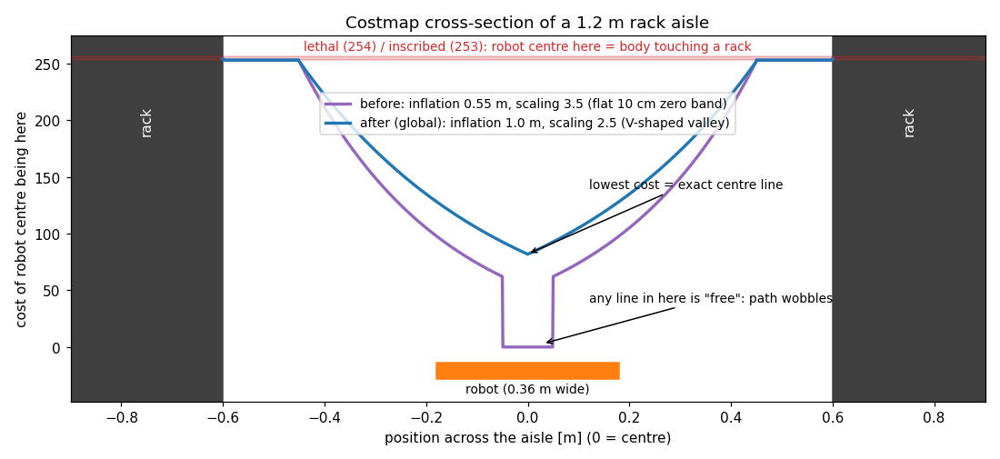
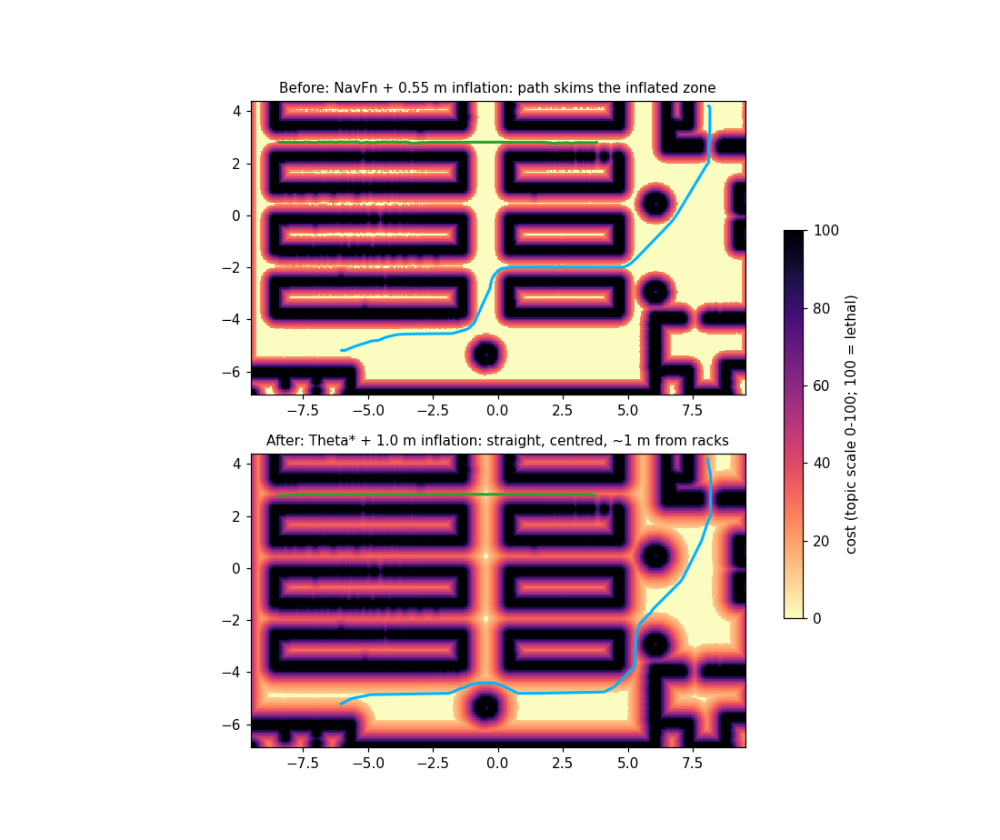
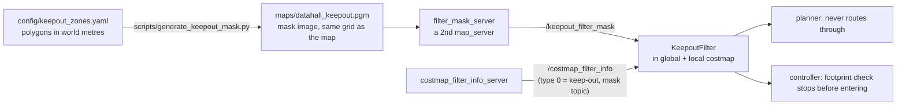
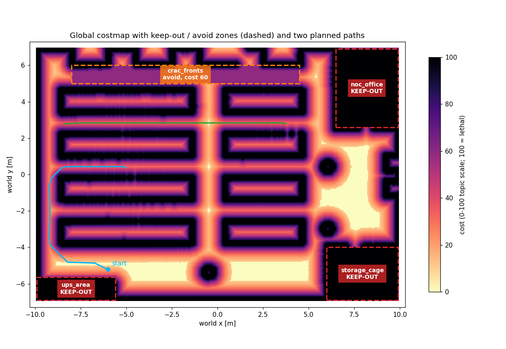

# Phase 4: Autonomous navigation (Nav2 + AMCL)

**Goal:** given the map from Phase 3, click a point in RViz and have the robot drive there on
its own: localise on the map, plan a path around the racks, follow it, and recover if stuck.

Files added in `src/my_robot`:

| File | Purpose |
|---|---|
| `config/nav2_params.yaml` | all Nav2 parameters; every change from the defaults is marked `# TUNED` with the reason |
| `launch/nav.launch.py` | starts Nav2 (`nav2_bringup/bringup_launch.py`) with our map + params, and RViz |
| `rviz/nav.rviz` | map, keep-out zones, robot, laser, AMCL particles, both costmaps, global + local path, Nav2 panel |
| `config/keepout_zones.yaml` | keep-out / avoid zones as polygons (edit this) |
| `scripts/generate_keepout_mask.py` | turns the zones into the mask image `maps/datahall_keepout.{pgm,yaml}` |

## 1. The Nav2 stack: who does what



| Node | Job |
|---|---|
| `map_server` | loads `datahall.yaml` + `.pgm` and publishes it on `/map` (transient-local, latched) |
| `amcl` | works out *where on that map* the robot is; publishes TF `map → odom` |
| `planner_server` | **global planner**: shortest safe path from robot to goal over the whole map |
| `controller_server` | **local controller**: turns the path into velocity commands 20× per second |
| `velocity_smoother` | clips speed/acceleration so commands are physically gentle |
| `behavior_server` | recovery moves: spin, back up, wait |
| `bt_navigator` | the "brain": a behaviour tree that calls the others in order and handles failures |
| `lifecycle_manager_*` | starts all of the above in the right order (see § 6) |

Compared with Phase 3, **slam_toolbox is gone**: the map is now fixed and `amcl` takes over
publishing `map → odom`. The TF tree has exactly the same shape, so nothing else needs to change.

## 2. AMCL: localisation with a particle filter

**A**daptive **M**onte **C**arlo **L**ocalisation. The robot's pose is represented not as one
guess but as a **cloud of 500–2000 guesses (particles)**, each a possible (x, y, θ). In RViz
they are the small arrows around the robot ("Amcl Particle Swarm").

Each cycle (every 0.2 m or 0.2 rad of motion):

1. **Predict (motion model):** move every particle by the odometry step, plus random noise
   (`alpha1..4`). The cloud spreads out, because we're less sure after moving.
2. **Weight (sensor model):** for each particle, ask: *"if the robot were here, how well
   would the current scan fit the map?"* `likelihood_field` precomputes, for every map cell,
   the distance to the nearest wall. A beam ending near a wall scores high. 60 of the 360
   beams are used (`max_beams`).
3. **Resample:** draw a new cloud, picking good particles more often. Bad guesses die out,
   and the cloud tightens around the true pose.
4. **Adaptive (the "A"):** KLD sampling shrinks the number of particles when the cloud is
   tight (cheap) and grows it when uncertain.

The published pose is the mean of the best cluster. AMCL then publishes
`map → odom = (map → base_link) · (odom → base_link)⁻¹`, the correction that, combined with
odometry, puts the robot in the right place on the map.

**Initial pose.** A particle filter must start roughly in the right place (a 20 × 14 m hall
with four identical rack rows is a terrible place to search globally; see perceptual aliasing in
Phase 3). Because the `map` frame was created at the spawn point, the default spawn is
exactly (0, 0, 0) in the map, so we set `set_initial_pose: true` with that pose. **If you
spawn elsewhere, or AMCL gets lost, use RViz's _2D Pose Estimate_**: click where the robot is,
drag in the direction it faces. That publishes `/initialpose` and re-seeds the cloud there.

### SLAM (Phase 3) vs AMCL (Phase 4) in one line
SLAM asks *"where am I, and what does the world look like?"* AMCL asks only *"where am I,
given this map?"*. That's cheaper and more robust, but blind to a map that is wrong.

## 3. Costmaps: where it is safe to drive

A **costmap** is an occupancy grid where each cell holds a *cost* 0–254 for the robot's centre
being there. It is built from **layers**, combined in order:

| Layer | Source | Used in |
|---|---|---|
| `static_layer` | the saved map (`/map`) | global |
| `obstacle_layer` | live `/scan`: marks obstacles where beams end, clears cells beams pass through | global + local |
| `inflation_layer` | spreads cost outwards from every obstacle | global + local |

|  | Global costmap | Local costmap |
|---|---|---|
| Frame | `map` | `odom` |
| Size | whole map | 4 × 4 m rolling window around the robot |
| Update | 1 Hz | 5 Hz |
| Used by | planner | controller (collision checks, speed regulation) |

The local costmap lives in `odom` on purpose: odometry is smooth, whereas `map` can *jump*
when AMCL corrects. A jumping obstacle map right under the robot would make the controller twitch.

### How a costmap is built, step by step

```
 1. static layer (saved map)   2. + obstacle layer (live lidar)   3. + inflation
 . . . . . . . . . .           . . . . . . . . . .                 1 2 3 2 1 . . . . .
 . . . ■ . . . . . .           . . . ■ . . . . . .                 2 5 ■ 5 2 1 . . . .
 . . . ■ . . . . . .           . . . ■ . . . ● . .                 2 5 ■ 5 3 5 ● 5 2 .
 . . . ■ . . . . . .           . . . ■ . . . . . .                 2 5 ■ 5 2 3 5 3 1 .
 . . . . . . . . . .           . . . . . . . . . .                 1 2 3 2 1 1 2 1 . .
 ■ = wall from the map         ● = something the lidar sees now    numbers = cost: high next to
                               (a person, a box) not in the map    obstacles, fading with distance
```

Each cell's cost answers: *"how bad is it for the **centre** of the robot to be here?"*

| Cost | Name | Meaning |
|---|---|---|
| 254 | lethal | an obstacle is in this cell |
| 253 | inscribed | closer to an obstacle than the robot's inscribed radius (0.15 m): the body **certainly** touches it |
| 1–252 | inflated | possibly or nearly touching; the closer, the costlier. Formula: `252 · e^(−scaling · (d − 0.15))` |
| 0 | free | further than `inflation_radius` from everything |
| 255 | unknown | never observed |

The planner looks for the path with the lowest **length + cost**. Inflation therefore
controls *how far from obstacles* paths go.

### Inflation: why paths used to skim the racks, and the fix



With the original **0.55 m** inflation (purple):
- In a 1.2 m aisle the cost drops to **zero in a flat 10 cm band** in the middle. Every line
  inside that band costs the same, so the path wobbles from side to side.
- In open areas everything beyond 0.55 m is zero cost, so the shortest path **skims along the
  edge of the purple zone**, as close to the racks as it is allowed to be.

With **1.0 m** inflation and a gentler fall-off (blue), the two racks' cost curves meet in a
**V-shaped valley**. The single cheapest line is the exact centre of the aisle, so paths run
straight down the middle. In open areas paths now keep about 1 m from racks.

**Global vs local costmap use different inflation on purpose:**
- **global (1.0 m / 2.5):** shapes the *route*.
- **local (0.55 m / 3.5):** used by the controller for *safety*: collision checks and
  slowing down near racks. A wide local inflation would make it crawl everywhere.



Blue = start → NOC office, green = down aisle A/B. **Before:** the route cuts through narrow
aisles hugging the inflated zone. **After:** it takes the open service corridor, keeps its
distance, and goes through the gap between the row end and the column at its centre.

### The footprint: why not a circle
`base_link` is at the **drive axle**, which is near the *front* of the body (body spans
x = −0.23 … +0.13 m). The TurtleBot default `robot_radius: 0.22` centred on base_link would
leave the back 1 cm short and the front 9 cm too big. We give the real rectangle:

```yaml
footprint: "[[0.13, 0.18], [0.13, -0.18], [-0.23, -0.18], [-0.23, 0.18]]"
```

### Keep-out and avoid zones (costmap filter)

Some places must never be driven into even though the floor is free: a staff office, a locked
cage, the high-voltage UPS area. They aren't obstacles the lidar can see, so they're added as
an extra **filter** on top of the costmap layers.



1. **Zones file.** You describe each zone as a polygon in world coordinates (the same numbers
   as in Gazebo) with a `cost`: **100 = keep-out**, **1–99 = avoid** (allowed, but expensive),
   plus an optional `buffer` of fading cost around it so paths don't skim its edge.
2. **Mask generator.** Turns the zones into a greyscale image cell-aligned with the map:
   white = no restriction, black = keep-out, grey = avoid.
   (`mode: scale`, so pixel darkness maps linearly to 0–100.)
3. **filter_mask_server** publishes the image as an OccupancyGrid;
   **costmap_filter_info_server** tells the costmaps "the keep-out mask is on that topic".
4. **KeepoutFilter** runs *after* all layers on every costmap update: each cell becomes
   `max(normal cost, mask cost)`, with mask 100 → lethal (254).

Because it's in **both** costmaps:
- the planner can't route through a zone, and a goal inside one is rejected;
- the controller's footprint collision check (local costmap) stops the body from entering,
  even when cutting a corner.

| Zone | Type | Why |
|---|---|---|
| `noc_office` | keep-out | staff room |
| `storage_cage` | keep-out | locked, restricted |
| `ups_area` | keep-out | high-voltage cabinets + 0.4 m service clearance |
| `crac_fronts` | avoid (cost 60) | cooling-unit air intakes; used only if there's no reasonable detour |



**To change zones:** edit `src/my_robot/config/keepout_zones.yaml`, then

```bash
cd ~/ros2_ws && python3 src/my_robot/scripts/generate_keepout_mask.py && colcon build --symlink-install
```

and restart `nav.launch.py`. To run without zones: `ros2 launch my_robot nav.launch.py keepout:=false`.

## 4. Planner and controller

**Global planner: Theta\*.** There are **no waypoints**: the planner returns a dense
list of poses (one per 5 cm cell) from the robot to the goal, and recomputes it **once per
second** so new obstacles get routed around.

How grid planners work:
- **NavFn (Dijkstra, Nav2's default):** floods outward from the goal, giving every cell its
  cheapest total cost (distance + costmap cost) to the goal, then walks downhill from the
  robot. It can only step between neighbouring cells (8 directions), so diagonal stretches
  become **staircases** that the controller sees as wobble.
- **Theta\* (ours):** an A\* search (expands cells in order of *cost so far + straight-line
  distance to goal*) with one extra trick. When it reaches a new cell it checks whether there
  is a clear **line of sight** to its parent's parent. If so, it skips the middle cell. Paths
  come out as **a few long straight segments** at any angle ("any-angle planning").
  `w_traversal_cost: 2.0` makes it weigh costmap cost twice as much as length, so it still
  stays in the valley of the inflation.

Measured on 4 routes, planning only (no driving), against the old setup:

| Route | Total turning, NavFn + 0.55 m | Theta\* + 1.0 m |
|---|---|---|
| start → NOC office | 342° | 336° (but ~1 m from racks instead of skimming them) |
| start → aisle B/C | 318° | **215°** |
| straight down aisle A/B (12 m) | 107° (wobble) | **15°** |
| NOC → cage | 47° | 75° |

We also tried Smac Planner 2D (smoothed curves). It was equally centred and equally reliable
when driving. Theta\* was chosen for the straightest segments. (And an earlier test: NavFn with
`use_astar: true` hit NavFn's known *"Failed to create a plan from potential"* bug.)

**Local controller: Regulated Pure Pursuit (RPP)** instead of the default DWB.
- *Pure pursuit:* pick a "carrot" point on the path a **lookahead distance** ahead
  (0.3–0.9 m, scaled with speed), and drive the circular arc that hits it. Curvature
  κ = 2·y_carrot / L².
- *Regulated:* slow down on tight curves (`regulated_linear_scaling_min_radius`) and when the
  costmap cost around the robot is high (`use_cost_regulated_linear_velocity_scaling`), i.e.
  automatically slower in narrow aisles and doorways.
- *Rotate to heading:* if the path points > 45° away, turn on the spot first (a diff drive can).
- *Collision detection:* projects the footprint along the arc for 1 s; stops if it would hit.

Why not DWB: DWB samples hundreds of velocity pairs and scores them with ~7 weighted
"critics". It's powerful, but it has many interacting weights and tends to wobble in narrow
corridors. RPP has a handful of physically meaningful parameters (speeds, distances) and
produces smooth, predictable motion, which is ideal for a static data hall.

**Velocity smoother:** final stage before the wheels: max 0.4 m/s and 1.0 rad/s,
acceleration 1.0 m/s² and 2.0 rad/s². That's well below what makes the wheels slip (Phase 3).

## 5. Actions and the behaviour tree

### ROS 2 actions (new concept)
Topics are fire-and-forget streams; services are quick request → response. **Actions** are
for *long-running tasks*: a client sends a **goal**, the server **accepts** it, streams
**feedback** while working, and finally returns a **result**. The client can **cancel**
at any time. "Drive to (x, y)" is the textbook action:

```
NavigateToPose
  goal:     geometry_msgs/PoseStamped pose
  feedback: current_pose, distance_remaining, navigation_time, number_of_recoveries
  result:   (success / aborted / canceled)
```

RViz's *Nav2 Goal* button is just an action client. So is Phase 5's frontier explorer.

### The behaviour tree
`bt_navigator` executes `navigate_to_pose_w_replanning_and_recovery.xml`, simplified:

```
RecoveryNode (retry up to 6×)
├── PipelineSequence
│   ├── RateController 1 Hz → ComputePathToPose   (planner)
│   └── FollowPath                                (controller)
└── RoundRobin  (on failure, try the next one)
    ├── ClearCostmaps
    ├── Spin 90°
    ├── Wait 5 s
    └── BackUp 0.3 m
```

The `progress_checker` declares failure if the robot moves < 0.5 m in 10 s, which triggers
the recovery branch.

## 6. Lifecycle nodes

Nav2's servers are **managed (lifecycle) nodes** with states
`unconfigured → inactive → active`. `lifecycle_manager` walks them through
*configure* (load params, allocate) → *activate* (start publishing) in dependency order:
map_server before amcl, costmaps before planner, and so on. If one fails, it stops the rest
instead of half-running. `autostart: true` does this automatically at launch. You'll see
`Managed nodes are active` in the log when everything is up.

## 7. Tuning summary

| Area | Parameter | Default → ours | Why |
|---|---|---|---|
| AMCL | `alpha1..4` | 0.2 → **0.1** | odometry is accurate after the wheel fix |
| AMCL | `laser_min/max_range` | −1/100 → **0.12/12** | real lidar limits |
| AMCL | `set_initial_pose` | false → **true** at (0,0,0) | spawn point = map origin |
| AMCL | `update_min_d` | 0.25 → **0.2** | update more often in aisles |
| Costmaps | `robot_radius` → `footprint` | 0.22 circle → **rectangle** | base_link is not the body centre |
| Global costmap | `inflation_radius` / `cost_scaling_factor` | 0.55/3.0 → **1.0/2.5** | V-shaped cost valley: paths centred, ~1 m from racks |
| Local costmap | `inflation_radius` / `cost_scaling_factor` | 0.55/3.0 → **0.55/3.5** | tight band for collision checks and slow-down |
| Local costmap | size, layer | 3 m voxel → **4 m 2D obstacle layer** | 2D lidar; see further at 0.4 m/s |
| Planner | plugin | NavFn → **Theta\*** | straight any-angle segments instead of grid staircases |
| Planner | `expected_planner_frequency` | 20 → **10** | the BT replans at 1 Hz anyway |
| Controller | plugin | DWB → **Regulated Pure Pursuit** | smooth, few parameters, slows in tight spaces |
| Controller | speed | 0.26 → **0.4** m/s | |
| Goal checker | xy / yaw tolerance | 0.25/0.25 → **0.15/0.2** | small robot, accurate localisation |
| Smoother | accel | 2.5/3.2 → **1.0/2.0** | no wheel slip |

## 8. Results (headless test against ground truth)

Five `NavigateToPose` goals sent in sequence with `nav2_simple_commander`, robot starting at
the default spawn with no manual initial pose. "Loc. error" compares AMCL's estimate (TF
`map → base_link`) to Gazebo's ground truth.

| Goal | Through | Result | Sim time | Driven | Recoveries | Dist. to goal | Loc. error |
|---|---|---|---|---|---|---|---|
| Aisle B/C (west block) | service area, rack aisle | ✅ | 33.8 s | 11.5 m | 0 | 0.11 m | 0.07 m / 0.9° |
| Aisle A/B (east block) | service corridor, rack aisle | ✅ | 21.7 s | 8.1 m | 0 | 0.15 m | 0.01 m / 0.9° |
| NOC office | 1.0 m doorway | ✅ | 23.2 s | 8.4 m | 0 | 0.15 m | 0.06 m / 0.2° |
| Storage cage | 1.0 m gate | ✅ | 29.1 s | 9.3 m | 0 | 0.09 m | 0.04 m / 1.4° |
| Back to start | out of the cage gate, whole hall | ✅ | 48.1 s | 15.3 m | 0 | 0.07 m | 0.02 m / 1.9° |

**5/5 goals, 53 m, localisation error ≤ 10 cm / 2°** (final setup: Theta\* + RPP).
Over repeated runs the only hiccup is leaving the **1 m cage gate** with a sharp turn: in about
1 run in 2 the controller sees "collision ahead" at the gate post, stops, and the behaviour
tree does one recovery before continuing. That happened with both Theta\* and Smac 2D, so it's
the tight gate, not the planner. The goal still succeeds. Average speed
0.34 m/s (the cruise speed is 0.4; RPP slows near racks and doorways). "Distance to goal" is
up to 0.16 m because the goal checker accepts within 0.15 m *of AMCL's estimate*.

### With keep-out zones enabled

Same method, plus a check of **8 points on the robot's body outline** against every zone
polygon at ~10 Hz, using ground truth.

| Goal | Result | Driven | Recoveries | Body entered a zone? |
|---|---|---|---|---|
| inside NOC office (keep-out) | ❌ **rejected** (as intended) | 0.4 m (turned in place) | BT retried, then gave up after 26 s | no |
| inside storage cage (keep-out) | ❌ **rejected** (as intended) | 0.3 m | gave up after 26 s | no |
| aisle A/B east | ✅ | 13.6 m | 0 | no |
| east wall by the PDUs | ✅ | 9.8 m | 0 | no |
| NW corner (past the CRAC "avoid" strip) | ✅ | 22.3 m | 0 | no: routed around it |
| back to start (beside the UPS zone) | ✅ | 12.7 m | 0 | no |

Why a rejected goal takes 26 s: the planner reports *"start or goal is an obstacle"*, but
Humble's default behaviour tree treats every failure the same way. It clears costmaps, spins,
waits and retries before aborting. Phase 5's explorer will avoid this by checking the costmap
before sending a goal.

Measurement note: `/amcl_pose` is only published after the robot moves 0.2 m / 0.2 rad, so
right after arriving it can be stale (we first measured a misleading 11° error that way).
The live TF `map → base_link` is always current.

## 9. Do it yourself

```bash
# T1: simulation
ros2 launch my_robot sim.launch.py rviz:=false

# T2: Nav2 + RViz
ros2 launch my_robot nav.launch.py
```

Wait ~10 s for `Managed nodes are active` in T2. In RViz:
1. The robot should already sit on the map with a tight green particle cloud around it. If
   the laser (red) doesn't line up with the black walls, click **2D Pose Estimate** and drag
   from the robot's real position in its facing direction.
2. Click **Nav2 Goal**, click a free (white) spot, drag to set the final heading.
3. Watch: the **global path** appears, the robot rotates to face it, then drives;
   the **local costmap** (the coloured square) moves with it.
4. Try a goal behind a rack row, or one **inside the NOC office or the cage**. Those are
   keep-out zones (shaded in RViz's *Keepout Zones* display), so Nav2 refuses them.

Send a goal from the terminal instead (map coordinates; this one is in aisle A/B):

```bash
ros2 action send_goal /navigate_to_pose nav2_msgs/action/NavigateToPose "{pose: {header: {frame_id: map}, pose: {position: {x: 8.0, y: 8.0}, orientation: {w: 1.0}}}}" --feedback
```

Map coordinates = world coordinates + (6.0, 5.2) (the spawn offset, see Phase 3).

### Inspect what's happening

```bash
ros2 action list                         # /navigate_to_pose, /follow_path, /spin, ...
ros2 topic echo /amcl_pose --once        # AMCL's estimate + covariance
ros2 run tf2_ros tf2_echo map odom       # AMCL's correction (now instead of SLAM's)
ros2 topic hz /plan                      # ~1 Hz replanning while driving
ros2 param get /controller_server FollowPath.desired_linear_vel
```

### Troubleshooting

| Symptom | Cause / fix |
|---|---|
| Robot not on the map, or "frame map does not exist" | AMCL not localised: use **2D Pose Estimate** |
| Laser and walls don't line up | wrong initial pose: redo 2D Pose Estimate |
| Goal rejected / "no valid path" | goal inside a keep-out zone or an obstacle's inflated area; click elsewhere |
| Robot spins, waits, backs up | that's the recovery behaviour tree; it was stuck or the path was blocked |
| Nothing happens in T2 after launch | started before Gazebo; restart T2 once T1 shows the robot spawned |
