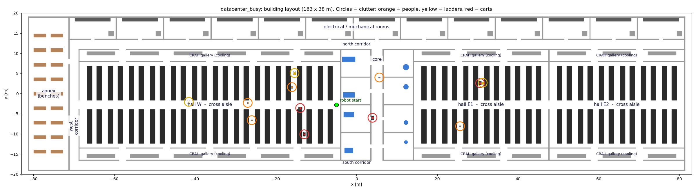
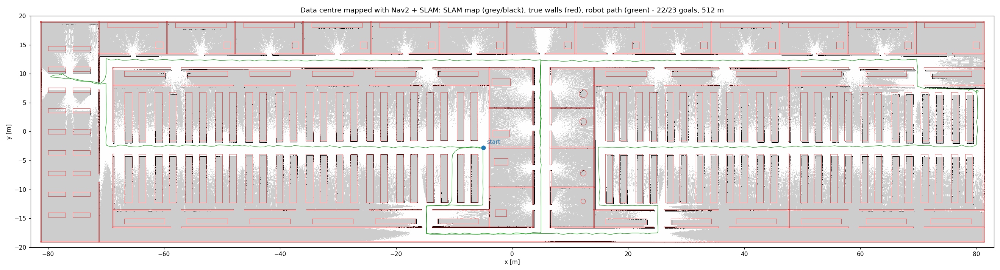
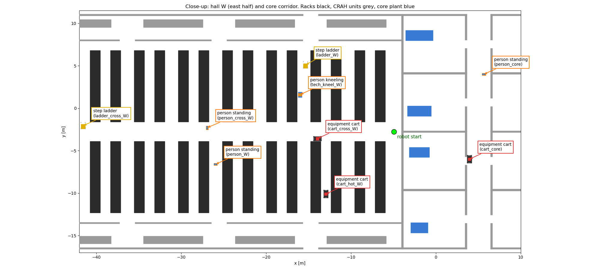

# Phase 4b: The whole data centre (big building, clutter, depth camera)

Phase 4 ran in one data hall (20 x 12 m). This phase scales up to a **whole data-centre
building** (~162 x 38 m: three halls, galleries, a core corridor, an electrical-room strip and
a staging annex), then makes it messy with **people, ladders and carts in the aisles**, which
is what a patrol robot actually meets. Every problem below was found by a headless test
against Gazebo ground truth and fixed. The fixes are explained here.



```bash
# clean building
ros2 launch dc_robot sim.launch.py world:=datacenter rviz:=false
ros2 launch dc_robot nav.launch.py world:=datacenter

# same building + people, ladders and carts in the aisles (not on the map!)
ros2 launch dc_robot sim.launch.py world:=datacenter_busy rviz:=false
ros2 launch dc_robot nav.launch.py world:=datacenter
```

Both worlds are generated by `scripts/generate_worlds.py`; the busy world is the clean one
plus 12 static clutter models (you can drag them around in the Gazebo GUI).

---

## 1. Mapping a building with long, identical corridors

### Corridor degeneracy

slam_toolbox matches each new scan against the map. In a long, featureless corridor every
position *along* the corridor fits equally well: the scan matcher cannot tell whether the
robot moved 1 m or 1.2 m. With the default parameters it trusted the (ambiguous) scan over
the (very good) wheel odometry and the map shrank: **1.0 m error after 140 m**.

Fix in `config/slam_params.yaml`: `distance_variance_penalty` 0.5 -> 0.05 and
`angle_variance_penalty` 1.0 -> 0.1. The penalty for straying from odometry is
`1 - 0.2 * d^2 / variance_penalty`, so being 25 cm off odometry now costs 25 % of the score
instead of 2.5 %: **0.4 m error** in the same corridor. Our odometry is accurate (<0.1 deg per
90 deg turn), so trusting it more is the right trade.

### Navigating while mapping (`slam:=true`)

```bash
ros2 launch dc_robot nav.launch.py world:=datacenter slam:=true keepout:=false
```

Nav2 then plans on the *growing* SLAM map. Two lessons:

* Nav2 rejects goals outside the current map ("Goal Coordinates were outside map bounds").
  A mapping driver has to "hop": go to the furthest **known-free** point towards the goal,
  let the map grow, repeat.
* Planning through **unknown** space (`allow_unknown`) in a building with long corridors
  leads into dead ends: lidar beams that hit nothing within 12 m do not clear cells, so
  corridors look unknown, and the planner happily routes through unscanned walls.
  Hop only into space already seen free (with a short step into unknown along a clear line).

Result of the full mapping drive: 22/23 targets reached, 512 m driven, map error <= 0.6 m,
back to ~15 cm after loop closure.



### But: the SLAM map only covered 56 % of the building

Aisle interiors were never scanned (the robot drove the corridors). AMCL later had nothing to
match against in an unmapped hot aisle and froze while the robot crept on. A patrol robot
needs a complete map. Two answers:

1. **Explore** until the map is complete (Phase 5 frontier explorer).
2. **Use the floor plan.** Real data centres have accurate CAD drawings, and robot fleets often
   localise on a map made from them. `scripts/world_to_map.py` does exactly that: every
   collision shape crossing the lidar plane (0.22 m) becomes an occupied cell.

```bash
python3 src/dc_robot/scripts/world_to_map.py --world datacenter --spawn -4.95 -2.75
```

`maps/datacenter.yaml` is now this floor-plan map (100 % coverage); the SLAM map is kept as
`maps/datacenter_slam.yaml` (`map:=` to use it).

---

## 2. AMCL in repetitive aisles

Rack aisles repeat every 5.2 m and look identical to a 2D lidar. With the default odometry
noise (`alpha1-4 = 0.2`) the particle cloud spread to 7.6 m, part of it landed in the
neighbouring aisle, and AMCL **jumped 10 m and 90 deg** to the wrong cluster.

| Parameter | Default | Now | Why |
|---|---|---|---|
| `alpha1..4` | 0.2 | 0.05 | odometry is accurate (<1 cm drift / 30 m in sim): keep the cloud tight |
| `z_hit` / `z_rand` | 0.5 / 0.5 | 0.8 / 0.2 | trust lidar hits more than "random" readings |
| `max_beams` | 60 | 120 | more evidence per update |

Result: mean localisation error 10 cm, max 49 cm, over 460 m.

---

## 3. Clutter the map does not know about



| Object | What the 0.22 m lidar sees |
|---|---|
| standing person | two legs (14 cm) |
| kneeling technician | a block |
| step ladder | four 4 cm rails |
| equipment cart | **four 3 cm legs** with castors, a bottom shelf at 0.19-0.22 m (just *below* the scan plane) |

The cart is the hard one. To the lidar it is four thin posts with a 0.44 m gap between them.
The planner routed **through** the cart; the robot drove its nose under the bottom shelf and
looped in recovery. A 2D lidar cannot fix this, so the robot got a second sensor.

### 3.1 Depth camera (RGB-D, like an Intel RealSense)

`urdf/sensors.xacro`: the front camera is now a Gazebo `depth` camera (87 deg FOV, 160x120,
10 Hz) on a short mast, **0.32 m above the floor, tilted 20 deg down**.

Why the mast? Mounted on the chassis at 0.12 m, the camera saw the cart's 3 cm shelf almost
edge-on (2 deg): only a few pixel rows hit it. From above, the shelf's top surface and front
face fill many pixels, and the tilt shrinks the blind zone right in front of the robot.

### 3.2 A 3D voxel layer in the costmaps

`config/nav2_params.yaml`, both costmaps:

```
plugins: ["obstacle_layer", "voxel_layer", "inflation_layer"]   (+ static_layer in global)
obstacle_layer : 2D, lidar only
voxel_layer    : 3D, depth camera only (12 voxels x 2.5 cm = 0 .. 0.30 m above the axle)
```

A **voxel** is a 3D cell. The voxel layer stores, for every 5 x 5 cm column, which 2.5 cm
slices are occupied; a column with any occupied slice becomes an obstacle in the 2D costmap.
Points below 0.02 m (the floor) and above 0.30 m (higher than the robot, it drives under) are
ignored.

Why two layers instead of feeding both sensors into one? Each layer clears only its own marks.
A lidar beam that passes *over* the cart's shelf cannot erase what the camera saw under it.

### 3.3 Four bugs found on the way (each one made the robot fail)

Each of these is a general lesson about costmaps, not specific to this robot:

1. **The costmap never got the point clouds.** At 320x240 the cloud is 2.4 MB per message
   (xyz + colour, organised, with NaNs). The costmaps subscribe best-effort inside the Nav2
   container and received only the very first cloud: the voxel grid stayed empty and the log
   said `Sensor origin at (0.12, 0.00, 0.27) is out of map bounds` (the robot's *start*
   position, never updated). Lowering the camera to 160x120 (0.6 MB) did *not* help. Fix: **`depth_cloud_relay`** (new node in this package, started
   by `nav.launch.py`) strips colour and NaNs and republishes `/camera/points_xyz`
   (12 bytes per point, ~0.2 MB). Real robots thin depth data before the costmap too.

2. **Planner and controller disagreed about the robot's width.** Theta* plans for a *point*
   and keeps it the footprint's *inscribed radius* (distance to the nearest edge) away from
   obstacles. `base_link` sits near the front, so that was 0.15 m, but the robot is 0.40 m wide
   (0.20 m half-width). A 0.30 m gap beside the cart looked passable to the planner, not to the
   controller: recovery loop. Fix: footprint front edge 0.13 -> 0.18 m (the mast is there now)
   and `footprint_padding` 0.05 in the **global** costmap (plan only through gaps >= 0.46 m,
   no knife-edge 0.40 m squeezes); the local costmap keeps 0.02 so the controller can still
   manoeuvre.

3. **Thin legs flickered.** With 1 deg lidar beams (7 cm apart at 4 m) a 3 cm cart leg was hit
   in some scans and missed in others, especially while turning. Missed beams clear the leg,
   the aisle looks open, the plan flips. Fix: lidar 360 -> **1440 samples (0.25 deg)**, like a
   Hokuyo UST-10LX: a 3 cm leg is hit in every scan out to ~7 m.

4. **"Clear but don't mark" range bands made an oscillator.** Each sensor has an
   `obstacle_max_range` (mark up to here) and a `raytrace_max_range` (clear up to here). The
   defaults clear further than they mark. Between the two ranges an obstacle is only ever
   *erased*. The cart's legs at 5-6 m: erased, the aisle looks free, the robot drives in;
   at <5 m: marked, the aisle is blocked, the robot turns back; at >5 m: erased again. It
   **shuttled 1.3 m back and forth for 15 minutes**. Fix: equal ranges (lidar 6.0/6.0 in the
   global costmap, camera 3.0/3.0).

How these were found: dump the costmap and the voxel grid around the cart
(`/local_costmap/voxel_grid`, `nav2_msgs/VoxelGrid`), and log `/cmd_vel_nav` with the plan
direction once per second while the robot is "stuck". The plan direction flipping between
-90 and +90 deg is what gave bugs 3 and 4 away.

```bash
# see it yourself in RViz: "Depth Camera" display (coloured by height) + the costmaps
ros2 topic hz /camera/points_xyz
ros2 topic echo /local_costmap/voxel_grid --once --field size_z
```

---

## 4. Results (headless, against Gazebo ground truth)

**Busy building** (`datacenter_busy`, clutter not on the map), 7 goals:

| Goal | Before camera | Now |
|---|---|---|
| cross aisle, past a cart | OK | OK |
| cross aisle, past a person | OK | OK |
| cold aisle by a kneeling technician | OK | OK |
| **hot aisle beyond a cart that blocks it** | **FAILED** (drove under the shelf, recovery loop) | **OK**: sees the aisle is blocked, backs out, goes round via the neighbouring aisle (88 s, 0 recoveries) |
| E1 aisle beyond a cart + ladder blockade | OK (detour) | OK (detour) |
| core corridor past a cart | OK | OK |
| back to start | OK | OK |

7/7, 256 m driven, localisation error <= 0.14 m with all the unmapped clutter.

**Regression** with all changes:

| World | Result |
|---|---|
| datahall (Phase 4) | 4/4 goals, both keep-out goals refused |
| datacenter (clean) | 5/5 goals (474 m, 0 recoveries), keep-out goal refused |
| SLAM mapping drive (1440-beam lidar) | 22/23 targets (same as with 360 beams); pose error median 0.14 m (was 0.30), final 0.10 m (was 0.15), but one excursion to 1.29 m in the north corridor (was max 0.60) before loop closure corrected it. One run each, so not yet conclusive; `maps/datacenter_slam.yaml` is still the 360-beam map |

---

## 5. Files

| File | What |
|---|---|
| `worlds/datacenter.world`, `worlds/datacenter_busy.world` | generated by `scripts/generate_worlds.py` |
| `maps/datacenter.yaml` | floor-plan map (`scripts/world_to_map.py`) |
| `maps/datacenter_slam.yaml` | the SLAM map from the mapping drive |
| `maps/datacenter_keepout.yaml` | keep-out mask (`config/keepout_zones_datacenter.yaml`) |
| `urdf/sensors.xacro` | 1440-beam lidar, depth camera on a mast |
| `dc_robot/depth_cloud_relay.py` | thins `/camera/points` -> `/camera/points_xyz` |
| `config/nav2_params.yaml` | voxel layer, footprint, ranges, AMCL tuning |
