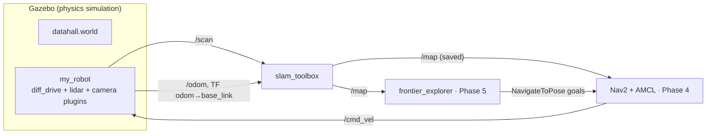

# Project documentation: phase by phase

Technical notes for each phase of the project: what was built, how it works under the hood,
the design decisions (and the bugs found along the way), and how to verify it yourself.

| Phase | Topic | Key concepts |
|---|---|---|
| [1. Environment](01-environment.md) | ROS 2 / Gazebo / Nav2 install and smoke test | ROS graph, TF, sim time |
| [2. Robot & world](02-robot-and-world.md) | `my_robot` URDF, sensors, Gazebo plugins, data-hall world | URDF/Xacro, inertia, diff drive, REP-105 frames |
| [3. SLAM](03-slam.md) | Mapping the data hall with slam_toolbox (99.9 % map precision) | Graph SLAM, scan matching, loop closure, occupancy grids, perceptual aliasing |
| [4. Navigation](04-navigation.md) | Nav2 + AMCL on the saved map, straight centred paths, keep-out zones (≤ 10 cm localisation error) | AMCL particle filter, costmaps & inflation, keep-out filters, Theta\* vs NavFn, planner vs controller, actions, behaviour trees, lifecycle nodes |
| 5. Autonomy | *planned* | Frontier exploration, Nav2 Simple Commander |
| 6. Polish | *planned* | |

## The big picture

Every phase adds one layer on top of the previous one, and every layer talks to the others
only through **topics, TF, and actions**. That is what lets the same Nav2 stack drive a
simulated robot or a real one.
